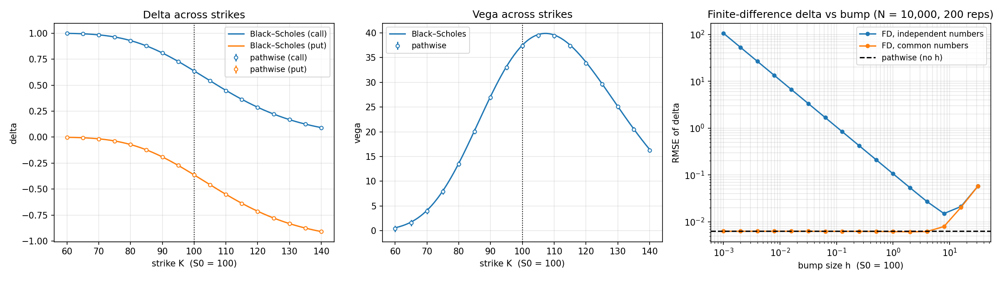
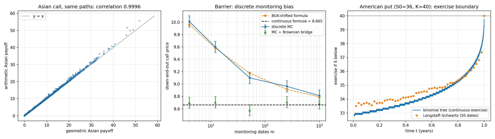
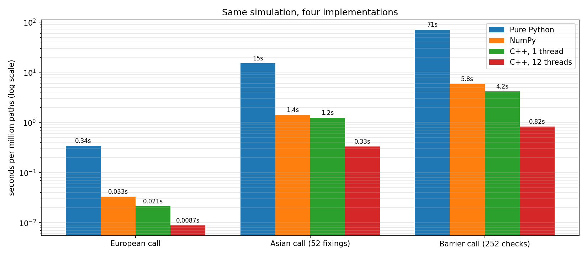

# Monte Carlo option pricing engine

A computational finance project: pricing options by Monte Carlo in Python, with a multithreaded C++ core exposed through pybind11. Every estimator is checked against an analytical formula or a binomial tree.

## Highlights

- **Convergence:** error falls like 1/√N (fitted slope −0.511), and 95% confidence intervals cover the true price 94.4% of the time.
- **Variance reduction:** up to **1,800×** less variance on Asian options using the geometric Asian as control variate. Sobol quasi-Monte Carlo converges like **1/N**.
- **Greeks:** the pathwise method matches Black–Scholes delta and vega at every strike, with no bump size to tune.
- **American options:** Longstaff–Schwartz regression prices the classic American put at **4.4775 ± 0.0092**, against 4.4779 from a binomial tree.
- **C++:** **39–86×** faster than pure Python and up to **7×** faster than vectorised NumPy, with 45 unit tests across Python and C++.

## Phases

| Phase | Content | Status |
|---|---|---|
| 1 | Black–Scholes, geometric Brownian motion, 1/√N convergence | ✅ |
| 2 | Variance reduction (antithetic variates, control variate, Sobol) | ✅ |
| 3 | Greeks: pathwise vs finite differences | ✅ |
| 4 | Exotics: Asian, barrier, American (Longstaff–Schwartz) | ✅ |
| 5 | C++ core + pybind11, speedup | ✅ |

## Results

### Phase 1: convergence


The log-log slope of the error is **−0.511** (theory: −0.5), and the 95% confidence interval contains the Black–Scholes price **94.4%** of the time. Full error table in [results/phase1_table.md](results/phase1_table.md).

### Phase 2: variance reduction


For an at-the-money call with the same number of simulations:
- antithetic variates cut the variance **2×**;
- the control variate cuts it **7×**;
- Sobol (quasi-Monte Carlo) converges like **1/N** (slope −1.01) instead of 1/√N.

Both antithetics and the control variate work far better for in-the-money calls. Table with timings and efficiency in [results/phase2_table.md](results/phase2_table.md).

### Phase 3: Greeks



Delta and vega by the pathwise method match the Black–Scholes formulas across all strikes (left, centre). The right panel shows why finite differences need **common random numbers**:
- with independent numbers, the error grows like 1/h and is unusable for small bumps;
- with common numbers, the error is flat and equals the pathwise error until the O(h²) bias takes over around h ≈ 8.

Pathwise gets both Greeks from the pricing simulation itself, with no bump size to tune. Every estimator against the analytical values in [results/phase3_table.md](results/phase3_table.md).

### Phase 4: exotic options



- **Asian call (arithmetic average, 12 fixings).** It has no closed form. The geometric-average Asian does, and its payoff is 0.9996-correlated with the arithmetic one (left), so it works as a control variate. That cuts the variance **600–1,800×**.
- **Down-and-out barrier call.** Checking the barrier only on discrete dates misses crossings in between, so the price comes out too high (centre): a bias that more paths cannot remove. The Broadie–Glasserman–Kou shifted barrier predicts that bias. A Brownian-bridge correction removes it, already with 4 monitoring dates.
- **American put via Longstaff–Schwartz.** Least-squares regression estimates the continuation value. It is fitted on one set of paths and priced on an independent one, like a train/test split. On the original paper's example it matches a 50-date Bermudan binomial tree within one standard error (e.g. 4.4775 ± 0.0092 vs 4.4779). A linear basis underfits and misprices by 0.06. The right panel shows the learned exercise boundary against the tree's.

Tables in [results/phase4_table.md](results/phase4_table.md).

### Phase 5: C++ core



[`cpp/mc_core.cpp`](cpp/mc_core.cpp) simulates one path at a time, so memory stays constant whatever the number of paths. It splits the paths across CPU threads, each with its own random generator, and is exposed to Python as `mcpricer_cpp` with pybind11. Time per million paths:

| Option | Pure Python | NumPy | C++, 1 thread | C++, 12 threads |
|:--|--:|--:|--:|--:|
| European call | 0.339 s | 0.033 s | 0.021 s | **0.009 s** |
| Asian call (52 fixings) | 15.1 s | 1.41 s | 1.24 s | **0.33 s** |
| Barrier call (252 checks) | 70.8 s | 5.83 s | 4.16 s | **0.82 s** |

The honest takeaway: vectorised NumPy already runs C under the hood, so single-threaded C++ only gains 1.1–1.5×. The big wins come from what NumPy can't do:
- stopping a path as soon as it hits the barrier;
- avoiding huge N × m arrays;
- using every core.

The barrier option benefits most. Scaling stops well short of 12× on this laptop chip (i7-1355U: 2 performance + 8 efficiency cores, 15 W). Full table in [results/phase5_table.md](results/phase5_table.md).

## Usage

```bash
pip install -r requirements.txt
python setup.py build_ext --inplace   # compiles the C++ core (needs a C++17 compiler; MSVC on Windows)
python -m pytest
python -m experiments.phase1_convergence
python -m experiments.phase2_variance_reduction
python -m experiments.phase3_greeks
python -m experiments.phase4_exotics
python -m experiments.phase5_speedup
```

## Layout

```
mcpricer/       Python package: Black–Scholes, Monte Carlo, variance reduction, Greeks, exotics, American
cpp/            C++ simulation core (pybind11 module mcpricer_cpp)
experiments/    one script per phase; each regenerates its plot and table in results/
tests/          pytest suite (the C++ tests are skipped until the extension is built)
```
