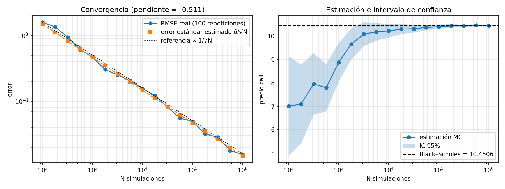
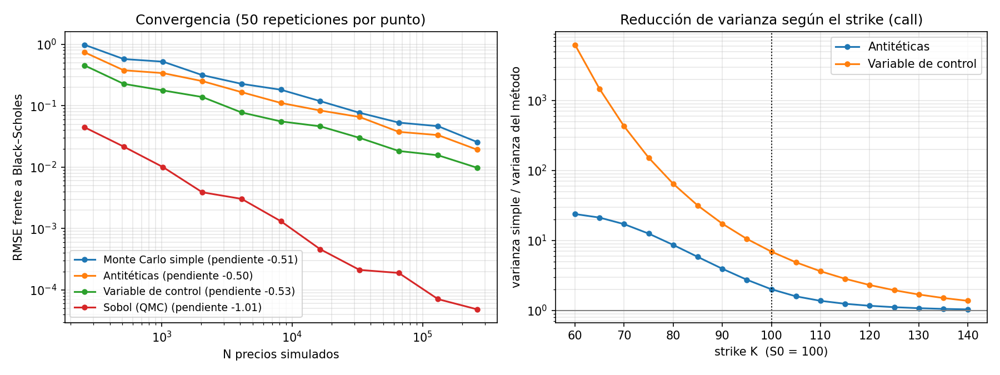

# Motor de valoración de opciones con Monte Carlo

Proyecto de aprendizaje de finanzas computacionales: valoración de opciones por Monte Carlo en Python (y después en C++ con pybind11), comparando siempre contra fórmulas analíticas.

## Fases

| Fase | Contenido | Estado | Notas |
|---|---|---|---|
| 1 | Black–Scholes, GBM, convergencia 1/√N | ✅ | [docs/01-base.md](docs/01-base.md) |
| 2 | Reducción de varianza (antitéticas, variable de control, Sobol) | ✅ | [docs/02-reduccion-varianza.md](docs/02-reduccion-varianza.md) |
| 3 | Griegas: pathwise vs diferencias finitas | ⏳ | |
| 4 | Exóticas: asiática, barrera, americana (Longstaff–Schwartz) | ⏳ | |
| 5 | Núcleo en C++ + pybind11, speedup | ⏳ | |

## Resultados



Pendiente log-log del error: **−0.511** (teoría −0.5). Cobertura del IC 95%: **94.4%**. Tabla completa en [results/phase1_table.md](results/phase1_table.md).



Call at-the-money, mismo número de simulaciones: antitéticas reducen la varianza **2×**, la variable de control **7×**, y Sobol converge como **1/N** (pendiente −1.01) en lugar de 1/√N. Tabla en [results/phase2_table.md](results/phase2_table.md).

## Uso

```bash
pip install -r requirements.txt
python -m pytest
python -m experiments.phase1_convergence
python -m experiments.phase2_variance_reduction
```
