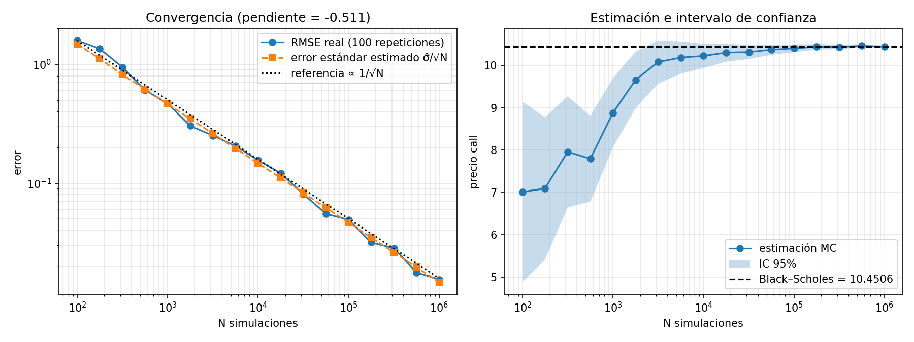

# Fase 1 — Black–Scholes, movimiento browniano geométrico y convergencia de Monte Carlo

**Código:** [`black_scholes.py`](../mcpricer/black_scholes.py) · [`monte_carlo.py`](../mcpricer/monte_carlo.py) · [`phase1_convergence.py`](../experiments/phase1_convergence.py)

**Parámetros que usamos en toda la fase:** $S_0 = 100$, $K = 100$, $T = 1$ año, $r = 5\%$, $\sigma = 20\%$.

---

## 1. ¿Qué es una opción y qué estamos valorando?

Una **call europea** con strike $K$ y vencimiento $T$ te da el *derecho*, pero no la obligación, de comprar el activo al precio $K$ en la fecha $T$.

- Si en $T$ el activo vale $S_T > K$, ejerces: compras a $K$ algo que vale $S_T$, así que ganas $S_T - K$.
- Si $S_T \le K$, no ejerces y ganas $0$.

Por tanto, el **payoff** (lo que cobras en $T$) es

$$
\text{call:}\quad (S_T - K)^+ = \max(S_T - K,\, 0)
\qquad\qquad
\text{put:}\quad (K - S_T)^+ = \max(K - S_T,\, 0)
$$

Una **put** es el derecho a *vender* a $K$.

El problema: hoy no sabemos cuánto valdrá $S_T$. **¿Cuánto debería costar hoy ese contrato?**

## 2. La idea clave: valoración neutral al riesgo

Ingenuamente dirías "precio = valor esperado del payoff". Casi, pero con dos matices:

1. **Descontar.** Un euro dentro de un año vale menos que un euro hoy. Con interés continuo $r$, un pago en $T$ se multiplica por $e^{-rT}$ para traerlo a hoy.
2. **¿Esperanza con qué probabilidades?** No con las "reales". El argumento de Black–Scholes es que puedes **replicar** la opción con una cartera de activo y dinero en el banco que se reajusta continuamente. Si dos cosas pagan lo mismo en todos los escenarios, deben costar lo mismo hoy; si no, habría **arbitraje** (ganancia sin riesgo). Ese precio de replicación resulta **no depender** de cuánto crees que va a subir el activo.

La consecuencia matemática es que el precio se puede calcular *como si* el activo creciera en media al tipo libre de riesgo $r$. A ese mundo ficticio se le llama **medida neutral al riesgo**, $\mathbb{Q}$:

$$
V_0 = e^{-rT}\, \mathbb{E}^{\mathbb{Q}}\big[\,\text{payoff}(S_T)\,\big]
$$

Esta fórmula es *todo* Monte Carlo: **simula muchos $S_T$ en el mundo $\mathbb{Q}$, calcula el payoff de cada uno, haz la media y descuenta.**

> **Interpretación.** $\mathbb{Q}$ no es "lo que creemos que pasará". Es una herramienta de cálculo que da el precio sin arbitraje. Por eso en el código la deriva es $r$, y no un rendimiento esperado $\mu$.

## 3. El modelo del activo: movimiento browniano geométrico

Black–Scholes supone que el precio sigue la ecuación diferencial estocástica

$$
dS_t = r\, S_t\, dt + \sigma\, S_t\, dW_t
$$

Léela así: en un instante pequeño $dt$, el **rendimiento** $dS_t / S_t$ es una parte determinista $r\,dt$ más un ruido $\sigma\, dW_t$, donde $dW_t$ es normal con media $0$ y varianza $dt$. El proceso $W_t$ es el **movimiento browniano**, y $\sigma$ es la **volatilidad**: cuánto ruido hay.

Que sea *geométrico* significa que el ruido es proporcional al precio. Así, el precio nunca es negativo, y lo que es normal son los rendimientos, no los precios.

### Solución exacta

Esta ecuación tiene solución cerrada:

$$
S_T = S_0 \exp\!\left( \left(r - \tfrac{1}{2}\sigma^2\right) T + \sigma \sqrt{T}\, Z \right),
\qquad Z \sim \mathcal{N}(0, 1)
$$

Por eso en `simulate_terminal` basta con generar $n$ normales $Z$ y aplicar esta fórmula. **No hace falta simular el camino paso a paso** para una opción europea, porque su payoff solo depende de $S_T$. Cuando lleguemos a asiáticas y barreras, que dependen del camino entero, sí lo haremos.

### ¿Por qué aparece el $-\tfrac{1}{2}\sigma^2$?

Es la parte que más confunde. Queremos que en $\mathbb{Q}$ el activo crezca en media al tipo $r$, es decir, $\mathbb{E}[S_T] = S_0 e^{rT}$. Un hecho de la distribución normal:

$$
X \sim \mathcal{N}(m, v) \quad\Longrightarrow\quad \mathbb{E}\big[e^{X}\big] = e^{\,m + v/2}
$$

La exponencial es convexa, así que los escenarios buenos pesan más que los malos (es la **desigualdad de Jensen**). En nuestro caso, $X = \left(r - \tfrac{1}{2}\sigma^2\right)T + \sigma\sqrt{T}\,Z$, con media $m = \left(r - \tfrac{1}{2}\sigma^2\right)T$ y varianza $v = \sigma^2 T$. Entonces

$$
\mathbb{E}[S_T] = S_0\, e^{\left(r - \frac{1}{2}\sigma^2\right)T \,+\, \frac{1}{2}\sigma^2 T} = S_0\, e^{rT} \quad \checkmark
$$

El $-\tfrac{1}{2}\sigma^2$ está ahí exactamente para cancelar el $+\tfrac{1}{2}\sigma^2$ que añade la convexidad. En cálculo estocástico esto sale del **lema de Itô** (la regla de la cadena para procesos aleatorios, que tiene un término extra de segundo orden). Para entender el código no necesitas Itô: basta con el hecho anterior sobre $\mathbb{E}[e^X]$.

Puedes comprobarlo tú mismo: la media de `simulate_terminal(...)` con muchas simulaciones da aproximadamente $100 \cdot e^{0.05} \approx 105.13$.

## 4. La fórmula de Black–Scholes, nuestra referencia

Si calculas esa esperanza a mano (es una integral contra la densidad normal), sale:

$$
C = S_0\, N(d_1) - K e^{-rT} N(d_2)
\qquad\qquad
P = K e^{-rT} N(-d_2) - S_0\, N(-d_1)
$$

$$
d_1 = \frac{\ln(S_0/K) + \left(r + \tfrac{1}{2}\sigma^2\right)T}{\sigma\sqrt{T}},
\qquad
d_2 = d_1 - \sigma\sqrt{T}
$$

donde $N(\cdot)$ es la función de distribución de la normal estándar (en el código, `norm.cdf`).

**Intuición de cada término:**

- $N(d_2)$ es la probabilidad, en $\mathbb{Q}$, de que la call acabe ejerciéndose ($S_T > K$). Así que $K e^{-rT} N(d_2)$ es el valor hoy de "pagar $K$ si ejerzo".
- $S_0\, N(d_1)$ es el valor hoy de "recibir el activo si ejerzo". Usa $d_1$ y no $d_2$ porque, cuando ejerces, el activo suele valer más de lo normal: el valor está condicionado a los escenarios altos.

**Paridad put–call.** Comprar una call y vender una put con el mismo strike paga $S_T - K$ en cualquier escenario, así que

$$
C - P = S_0 - K e^{-rT}
$$

Lo comprobamos en `test_put_call_parity`. Es una forma barata de detectar errores en las fórmulas.

Con nuestros parámetros: **call $= 10.4506$**, **put $= 5.5735$**.

## 5. El estimador Monte Carlo

Llamamos $Y_i = e^{-rT}\, \text{payoff}\big(S_T^{(i)}\big)$ al payoff descontado de la simulación $i$. Con $N$ simulaciones independientes, el estimador es la media:

$$
\hat{V}_N = \frac{1}{N} \sum_{i=1}^{N} Y_i
$$

- **Ley de los grandes números:** $\hat{V}_N \to V_0$ cuando $N \to \infty$. Además, el estimador es **insesgado**: su media es exactamente el precio, para cualquier $N$.
- **Teorema central del límite (TCL):** para $N$ grande, $\hat{V}_N$ es aproximadamente normal, con media $V_0$ y desviación típica

$$
\mathrm{SE} = \frac{\sigma_Y}{\sqrt{N}}
$$

Aquí $\sigma_Y$ es la desviación típica de **un** payoff descontado. No hay que confundirla con la $\sigma$ del activo. No conocemos $\sigma_Y$, pero la estimamos con la desviación típica muestral $\hat{\sigma}_Y$, que en el código es `discounted.std(ddof=1)`. El `ddof=1` divide por $N-1$ en lugar de por $N$, que es la versión insesgada de la varianza.

### Por qué el error baja como $1/\sqrt{N}$

La varianza de una media de $N$ variables independientes es $\operatorname{Var}(Y)/N$, y la desviación típica es su raíz: $\sigma_Y/\sqrt{N}$. Consecuencias prácticas:

- **Para dividir el error entre 10 necesitas 100 veces más simulaciones.** Eso es caro, y es la razón de ser de la **fase 2** (reducción de varianza): en lugar de aumentar $N$, reducimos $\sigma_Y$.
- La tasa $1/\sqrt{N}$ **no depende de la dimensión** del problema. Una opción sobre 50 activos converge igual de rápido. Por eso Monte Carlo gana a otros métodos numéricos (árboles, ecuaciones en derivadas parciales) cuando hay muchas variables.

### Intervalo de confianza al 95%

Como $\hat{V}_N$ es aproximadamente normal, el 95% de las veces cae a menos de $1.96$ errores estándar del valor real:

$$
\Big[\, \hat{V}_N - 1.96\,\mathrm{SE}\,,\;\; \hat{V}_N + 1.96\,\mathrm{SE} \,\Big]
$$

**Interpretación correcta:** si repites el experimento muchas veces, el 95% de los intervalos que construyas contendrán el precio verdadero. Un intervalo concreto lo contiene o no lo contiene.

## 6. Resultados

Para reproducirlos: `python -m experiments.phase1_convergence`

### Panel izquierdo: el error en escala log-log

Con escala logarítmica en ambos ejes, la relación $\text{error} = c/\sqrt{N}$ se convierte en

$$
\log(\text{error}) = \log(c) - \tfrac{1}{2} \log(N)
$$

es decir, una **recta de pendiente $-\tfrac{1}{2}$**. La recta ajustada da **$-0.511$**. Hay dos curvas casi superpuestas:

- **RMSE real.** Para cada $N$ repetimos el cálculo 100 veces con semillas distintas y medimos el error cuadrático medio frente a Black–Scholes. Un solo error es muy ruidoso; promediar muestra la tendencia.
- **Error estándar estimado.** Es lo que el propio Monte Carlo dice que es su error, sin conocer la respuesta correcta. Que coincida con el RMSE significa que **el SE es fiable**. Esto importa porque en la fase 4 (asiáticas aritméticas, americanas) no tendremos fórmula con la que comparar, y el SE será lo único que tengamos.

### Panel derecho: una sola estimación según crece $N$

Usamos una sola semilla y aumentamos $N$. Con NumPy, los primeros $N$ números de una semilla son siempre los mismos, así que esta curva es la media acumulada de una única tirada larga. Al principio salta mucho, y la banda azul (el intervalo de confianza) se estrecha como $1/\sqrt{N}$.

Fíjate en que con $N$ entre 100 y 600 el intervalo **no contiene** el valor real. No es un error del código:

1. El 5% de las veces el intervalo *debe* fallar. Y como estos puntos comparten números aleatorios, fallan juntos.
2. Con $N$ pequeño el TCL aún no funciona bien. El payoff de una call es muy asimétrico (muchos ceros y unos pocos valores grandes), así que la media tarda en comportarse como una normal.

### Cobertura de los intervalos

En las 1 700 repeticiones (17 valores de $N$ × 100 repeticiones), el intervalo del 95% contuvo el precio real el **94.4%** de las veces. Es justo lo que predice la teoría.

### Tabla de errores frente a Black–Scholes

$N = 1\,000\,000$ simulaciones.

| Tipo | $K$ | Black–Scholes | Monte Carlo | Error | SE | $\lvert\text{error}\rvert / \text{SE}$ |
|:--|--:|--:|--:|--:|--:|--:|
| call | 80 | 24.5888 | 24.5905 | +0.0017 | 0.0192 | 0.09 |
| call | 90 | 16.6994 | 16.6615 | −0.0379 | 0.0173 | 2.19 |
| call | 100 | 10.4506 | 10.4411 | −0.0095 | 0.0147 | 0.65 |
| call | 110 | 6.0401 | 6.0221 | −0.0180 | 0.0116 | 1.54 |
| call | 120 | 3.2475 | 3.2497 | +0.0022 | 0.0087 | 0.26 |
| put | 80 | 0.6872 | 0.6897 | +0.0025 | 0.0027 | 0.93 |
| put | 90 | 2.3101 | 2.3211 | +0.0110 | 0.0054 | 2.06 |
| put | 100 | 5.5735 | 5.5802 | +0.0067 | 0.0087 | 0.77 |
| put | 110 | 10.6753 | 10.6924 | +0.0171 | 0.0120 | 1.43 |
| put | 120 | 17.3950 | 17.3859 | −0.0091 | 0.0148 | 0.61 |

**Cómo leerla.** La columna importante es la última, el error medido en errores estándar. Si Monte Carlo funciona, debería comportarse como el valor absoluto de una normal estándar: casi siempre menor que 2 y muy raramente mayor que 3. Aquí todo está por debajo de 2.2.

**Errores correlacionados.** Los dos casos con $K = 90$ superan 2 *a la vez*. La razón es que la call y la put usan la misma semilla (`seed=K`), así que comparten escenarios: si esos escenarios salieron algo bajos, la call sale baja y la put sale alta. Usar los mismos números aleatorios *a propósito* es la base de las griegas por diferencias finitas de la fase 3.

**Opciones muy fuera de dinero.** El SE absoluto de la put con $K = 80$ es muy pequeño ($0.0027$) porque casi todos sus payoffs son $0$ y hay poca varianza. Pero en términos relativos ($0.0027 / 0.69 \approx 0.4\%$) es peor que la call at-the-money ($0.0147 / 10.45 \approx 0.14\%$). Las opciones muy fuera de dinero son difíciles para Monte Carlo porque pocos escenarios aportan información. Esto motiva técnicas como el *importance sampling*.

## 7. Comprueba que lo has entendido

1. Cambia `sigma` a `0.4` en el script. ¿Qué les pasa al precio de Black–Scholes y al error estándar? ¿Por qué tiene sentido que suban los dos?
2. Quita el término `- 0.5 * sigma**2` de `simulate_terminal` y ejecuta los tests. ¿Cuáles fallan? ¿Por qué el precio de la call sale demasiado alto?
3. Sin ejecutar nada: si con $N = 10\,000$ el SE es $0.15$, ¿cuántas simulaciones necesitas para un SE de $0.005$?
4. ¿Por qué no podemos usar la misma idea (una normal por escenario, sin pasos de tiempo) para una opción cuyo payoff depende del **máximo** del precio durante el año?

<b>Respuestas</b>

 

1. Con más volatilidad hay más escenarios con $S_T$ muy alto, y la call se beneficia de ellos sin sufrir los malos, porque su payoff nunca baja de $0$. El precio sube (a unos $18.02$). Los payoffs están más dispersos, así que $\sigma_Y$ sube y el SE también.
2. Sin la corrección, $\mathbb{E}[S_T] = 100 \cdot e^{0.05 + 0.02}$: el activo crece en media más que $r$, así que la call vale más y la put menos. Fallan los tests de Monte Carlo frente a Black–Scholes; los analíticos siguen pasando porque no usan la simulación.
3. Quieres un error 30 veces menor, así que necesitas $30^2 = 900$ veces más simulaciones: $9\,000\,000$.
4. Porque el máximo depende de todo el camino, no solo del punto final. Hay que simular $S_t$ en muchas fechas intermedias, y aun así el máximo en fechas discretas subestima el máximo continuo. Lo veremos con la opción con barrera.

