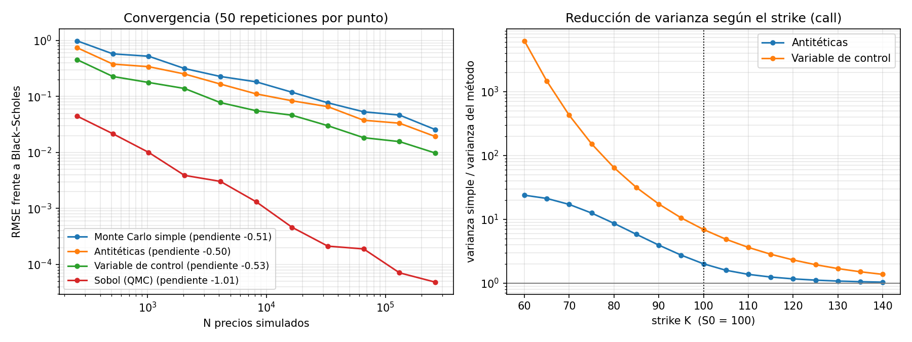

# Fase 2 — Reducción de varianza

**Código:** [`variance_reduction.py`](../mcpricer/variance_reduction.py) · [`phase2_variance_reduction.py`](../experiments/phase2_variance_reduction.py) · [`test_phase2.py`](../tests/test_phase2.py)

**Parámetros:** los de la fase 1 ($S_0 = 100$, $K = 100$, $T = 1$, $r = 5\%$, $\sigma = 20\%$), salvo que se diga otra cosa.

---

## 1. El problema que queremos resolver

En la fase 1 vimos que el error estándar de Monte Carlo es

$$
\mathrm{SE} = \frac{\sigma_Y}{\sqrt{N}}
$$

Para reducirlo hay dos palancas:

- **Aumentar $N$.** Funciona, pero es caro: dividir el error entre 10 cuesta 100 veces más simulaciones.
- **Reducir $\sigma_Y$.** Si construimos otro estimador con la **misma media** (el precio) pero **menos varianza por simulación**, ganamos sin pagar más simulaciones.

Esta fase va de la segunda palanca. Las tres técnicas que vamos a ver explotan algo que sabemos del problema y que Monte Carlo simple ignora.

### Cómo comparar métodos de forma justa: la eficiencia

Un método que reduce la varianza a la mitad pero tarda el triple no compensa: con el método simple y el triple de simulaciones habrías reducido la varianza a un tercio. Lo que importa es la combinación de las dos cosas:

$$
\text{eficiencia} = \frac{1}{\text{varianza por simulación} \times \text{tiempo por simulación}}
$$

La **ganancia de eficiencia** de un método frente al simple es

$$
\text{ganancia} = \frac{\sigma^2_{\text{simple}} \cdot t_{\text{simple}}}{\sigma^2_{\text{método}} \cdot t_{\text{método}}}
$$

Se lee así: "para conseguir el mismo error, el método simple necesita *ganancia* veces más tiempo de cálculo".

En todas las comparaciones, $N$ es el **número total de precios $S_T$ simulados**, sea cual sea el método.

---

## 2. Variables antitéticas

### La idea

Si $Z \sim \mathcal{N}(0,1)$, entonces $-Z$ también es $\mathcal{N}(0,1)$. Así que, por cada normal $Z$ que generamos, podemos simular **dos** escenarios: uno con $Z$ y otro con $-Z$. Si $Z$ dio un escenario muy alto, $-Z$ da uno muy bajo, y la media de los dos se acerca más al valor medio que cualquiera de los dos por separado.

Con $N/2$ normales se simulan $N$ precios, y el estimador es

$$
\hat{V}^{\text{anti}} = \frac{1}{N/2} \sum_{i=1}^{N/2} \frac{Y(Z_i) + Y(-Z_i)}{2}
$$

### Por qué funciona (y cuándo)

Llama $Y = Y(Z)$ e $Y' = Y(-Z)$. Las dos tienen la misma varianza $\sigma_Y^2$, y su correlación es $\rho$. La varianza de la media del par es

$$
\operatorname{Var}\!\left(\frac{Y + Y'}{2}\right) = \frac{\sigma_Y^2}{2}\,(1 + \rho)
$$

Compáralo con promediar **dos simulaciones independientes**, que da $\sigma_Y^2 / 2$. El factor de mejora es

$$
\frac{\sigma_Y^2 / 2}{\sigma_Y^2 (1+\rho)/2} = \frac{1}{1 + \rho}
$$

- Si $\rho < 0$ (los dos escenarios se compensan), ganamos.
- Si $\rho = -1$ (compensación perfecta), la varianza es cero.
- Si $\rho > 0$, ¡perdemos! Sería peor que Monte Carlo simple.

**¿Cuándo es $\rho$ negativo?** Hay un resultado general: si el payoff es una función **monótona** de $Z$, la correlación entre $Y(Z)$ e $Y(-Z)$ es siempre $\le 0$. La call es monótona creciente en $Z$ (más $Z$ implica más $S_T$ y nunca menos payoff), así que con una call nunca perdemos. Con un payoff no monótono, por ejemplo un *straddle* $|S_T - K|$, sí podríamos perder.

### Un detalle importante en el código

Las dos mitades de un par **no son independientes**, así que no podemos calcular el error estándar con las $N$ simulaciones como si lo fueran. Lo correcto es tratar cada par como una sola observación, la media del par, y calcular la desviación típica sobre esas $N/2$ medias. Eso hace `mc_antithetic`.

### Coste

Generar números normales es lo más caro de nuestra simulación, y con antitéticas solo generamos la mitad. Por eso, en lugar de costar más, **es algo más rápido** que Monte Carlo simple.

---

## 3. Variable de control

### La idea

Supón que, junto al payoff $Y$, simulamos otra cantidad $X$ cuya media $\mathbb{E}[X]$ **conocemos exactamente**. En cada simulación podemos ver cuánto se ha desviado $X$ de su media. Si $X$ e $Y$ están correlacionadas, esa desviación nos dice algo sobre cuánto se ha desviado también $Y$, y podemos corregirla:

$$
Y_b = Y - b\,\big(X - \mathbb{E}[X]\big)
$$

Como $\mathbb{E}[X - \mathbb{E}[X]] = 0$, el nuevo estimador tiene **la misma media** que $Y$, sea cual sea $b$. Solo cambia la varianza.

**Nuestra elección:** $X = e^{-rT} S_T$, el propio activo descontado. Por la propiedad que vimos en la fase 1, $\mathbb{E}[X] = S_0$ exactamente. Y $X$ está muy correlacionada con el payoff de la call: cuando el activo sube, la call paga más.

Ejemplo concreto: si en nuestras simulaciones la media de $X$ ha salido $100.3$ en lugar de $100$, sabemos que hemos tenido "suerte" (escenarios algo altos), así que nuestra estimación de la call probablemente también ha salido alta. La variable de control la corrige hacia abajo.

### El $b$ óptimo

La varianza de $Y_b$ es

$$
\operatorname{Var}(Y_b) = \sigma_Y^2 - 2b\,\operatorname{Cov}(Y, X) + b^2 \sigma_X^2
$$

Es una parábola en $b$. Derivando e igualando a cero, el mínimo está en

$$
b^* = \frac{\operatorname{Cov}(Y, X)}{\operatorname{Var}(X)}
$$

y la varianza mínima es

$$
\operatorname{Var}(Y_{b^*}) = \sigma_Y^2\,\big(1 - \rho_{XY}^2\big)
$$

donde $\rho_{XY}$ es la correlación entre $X$ e $Y$. El factor de mejora es $1/(1 - \rho^2)$: con $\rho = 0.9$ ya es $5.3\times$, y con $\rho = 0.99$ es $50\times$. Fíjate en que aquí el signo de $\rho$ da igual, porque está al cuadrado.

### Conexión con machine learning

$b^*$ es exactamente la **pendiente de una regresión lineal por mínimos cuadrados** de $Y$ sobre $X$. Y $Y_{b^*}$ es el **residuo** de esa regresión, más la media. Es decir: la variable de control "quita" de $Y$ la parte que se explica linealmente con $X$, y Monte Carlo solo tiene que promediar lo que queda. Cuanto mayor sea el $R^2$ de la regresión ($R^2 = \rho^2$), más varianza se elimina.

Esta misma idea, la regresión para explicar una parte del payoff, reaparece en la fase 4 con **Longstaff–Schwartz** para opciones americanas.

### Un detalle: estimar $b$

No conocemos $b^*$, así que lo estimamos con la covarianza y la varianza muestrales de las propias simulaciones (`np.cov` en el código). Usar la misma muestra para estimar $b$ y para el precio introduce un sesgo pequeño, de orden $1/N$, que con cientos de miles de simulaciones es despreciable. Si importara, se estima $b$ con una muestra piloto aparte.

### Coste

Hay que calcular la covarianza y la varianza, así que **es algo más lento** que Monte Carlo simple.

---

## 4. Sobol: quasi-Monte Carlo

### La idea

Los números aleatorios forman grupos y dejan huecos por puro azar. Si tiras 16 puntos uniformes en $[0, 1]$, lo normal es que algunos intervalos de ancho $1/16$ tengan dos o tres puntos y otros ninguno. Esas irregularidades son exactamente el error de Monte Carlo.

Las **secuencias de baja discrepancia**, como la de **Sobol**, son deterministas y están construidas para rellenar el espacio lo más uniformemente posible: con 16 puntos de Sobol hay exactamente uno en cada intervalo de ancho $1/16$. Después transformamos esos uniformes $u$ en normales con la inversa de la función de distribución, $Z = N^{-1}(u)$ (`norm.ppf` en el código).

### Por qué el error baja más rápido

Para Monte Carlo, el error es del orden de $1/\sqrt{N}$. Para quasi-Monte Carlo en dimensión $d$, la **desigualdad de Koksma–Hlawka** acota el error por

$$
\text{error} \;\lesssim\; \frac{(\log N)^d}{N}
$$

En dimensión baja, como nuestro caso ($d = 1$, una sola normal por escenario), esto es esencialmente $1/N$: **dividir el error entre 10 cuesta solo 10 veces más puntos**, no 100.

### Dos pegas importantes

1. **No hay error estándar "gratis".** Los puntos de Sobol no son independientes, así que la fórmula $\sigma_Y / \sqrt{N}$ no tiene sentido. La solución es el **scrambling**: aplicar una permutación aleatoria a la secuencia que mantiene su buen reparto. Repetimos el cálculo con varias aleatorizaciones independientes (16 en el código) y medimos la dispersión de sus resultados. A esto se le llama **randomized QMC**.
2. **La dimensión importa.** El $(\log N)^d$ de la fórmula crece muy rápido con $d$. Con una opción que depende de un camino de 252 días, $d = 252$, y la ventaja de Sobol se reduce mucho (aunque en la práctica sigue ayudando bastante con buenos trucos de construcción). Lo veremos en la fase 4.

Además, Sobol está equilibrado cuando el número de puntos es una **potencia de 2**, por eso el código lo exige.

---

## 5. Resultados

Para reproducirlos: `python -m experiments.phase2_variance_reduction`

### Tabla: call at-the-money, $N = 2^{18} = 262\,144$

| Método | Precio | Error estándar | Reducción de varianza | Tiempo (ms) | Coste relativo | Ganancia de eficiencia |
|:--|--:|--:|--:|--:|--:|--:|
| Monte Carlo simple | 10.4622 | 0.02875 | 1.0× | 18.6 | 1.00× | 1.0× |
| Antitéticas | 10.4443 | 0.02028 | 2.0× | 13.2 | 0.71× | 2.8× |
| Variable de control | 10.4471 | 0.01094 | 6.9× | 31.5 | 1.70× | 4.1× |
| Sobol (QMC) | 10.4505 | 0.00009 | ≈ 108 000× | 17.0 | 0.91× | ≈ 118 000× |

Black–Scholes $= 10.4506$.

**Antitéticas.** Reducen la varianza a la mitad ($2.0\times$). Según la fórmula $1/(1+\rho)$, eso significa que la correlación entre $Y(Z)$ e $Y(-Z)$ es $\rho \approx -0.5$. Como además son más rápidas, la ganancia de eficiencia es mayor que la reducción de varianza.

**Variable de control.** Reduce la varianza unas 7 veces. Por la fórmula $1/(1 - \rho^2)$, la correlación entre la call y el activo es $\rho \approx 0.93$. Cuesta más tiempo, pero sigue compensando claramente.

**Sobol.** Su error es unas 300 veces menor que el de Monte Carlo simple, con el mismo número de puntos y en un tiempo parecido. Pero la cifra de $108\,000\times$ hay que leerla con cuidado: como su error baja como $1/N$ en lugar de $1/\sqrt{N}$, la "reducción de varianza" no es un factor fijo, **crece con $N$**. Esa cifra solo vale para $N = 2^{18}$.

> **Sobre los tiempos.** Son medidas de unos pocos milisegundos y varían bastante de una ejecución a otra (en otra ejecución salió $0.57\times$ para antitéticas y $1.34\times$ para la variable de control). Fíate del orden de magnitud, no del segundo decimal. El código toma el mínimo de 7 repeticiones, que es la medida menos contaminada por otros programas del ordenador.

### Panel izquierdo: convergencia

Las tres primeras curvas son **paralelas**, con pendiente $\approx -\tfrac{1}{2}$. Esto es clave: **antitéticas y variable de control no cambian la tasa de convergencia**, solo bajan la curva (reducen la constante $\sigma_Y$). En escala logarítmica, bajar la curva un factor $c$ equivale a desplazarla horizontalmente: es lo mismo que haber usado $c^2$ veces más simulaciones.

Sobol es distinto: su pendiente es **$-1.01$**. No solo empieza más abajo, sino que **baja más rápido**, y la distancia con las demás crece con $N$.

### Panel derecho: depende de dónde esté el strike

Este gráfico muestra la reducción de varianza para calls con strikes entre 60 y 140. Las dos técnicas funcionan **mucho mejor con calls muy dentro de dinero** ($K$ pequeño) y casi nada con calls muy fuera de dinero ($K$ grande).

- **Muy dentro de dinero** ($K = 60$): casi siempre se ejerce, así que el payoff es prácticamente $S_T - K$, una función casi lineal del activo. La variable de control (que es el activo) explica casi todo: reducción de $6\,264\times$. Y con un payoff casi lineal en $S_T$, $Y(Z)$ e $Y(-Z)$ se compensan casi perfectamente: $24\times$ con antitéticas.
- **Muy fuera de dinero** ($K = 140$): casi todos los payoffs son $0$. Lo que pasa en unos pocos escenarios extremos apenas se correlaciona linealmente con $S_T$, así que ninguna de las dos técnicas ayuda mucho ($1.4\times$ y $1.04\times$).

**La lección general:** una técnica de reducción de varianza funciona en la medida en que captura la estructura del payoff. Para una opción muy fuera de dinero, la variable de control "correcta" sería otra, o habría que usar *importance sampling*, que consiste en simular más escenarios en la zona donde el payoff no es cero.

---

## 6. Resumen

| Técnica | Qué explota | Mejora típica | Cambia la tasa $1/\sqrt{N}$ | Cuándo falla |
|:--|:--|:--|:--|:--|
| Antitéticas | Simetría de la normal | $1/(1+\rho)$ | No | Payoffs no monótonos |
| Variable de control | Algo correlacionado con media conocida | $1/(1-\rho^2)$ | No | Si no hay buen control correlacionado |
| Sobol | Reparto uniforme de los puntos | Crece con $N$ | Sí, a $\approx 1/N$ | Dimensión alta, payoffs con saltos |

Las técnicas se pueden **combinar**: por ejemplo, antitéticas con variable de control, o Sobol con variable de control. En la fase 4 usaremos una variable de control mucho mejor para la opción asiática.

---

## 7. Comprueba que lo has entendido

1. Con antitéticas, ¿por qué sería un error calcular el error estándar como `Y.std() / sqrt(N)` usando las $N$ simulaciones por separado? ¿Saldría más grande o más pequeño que el real?
2. Para una **put** muy dentro de dinero (por ejemplo, $K = 140$), ¿esperas que la variable de control $X = e^{-rT}S_T$ funcione bien? ¿Qué signo tendrá $b^*$?
3. El test `test_control_variate_is_exact_for_the_asset_itself` comprueba que una call con $K = 0$ tiene error estándar $0$ con la variable de control. ¿Por qué?
4. Si con Sobol el error es $10^{-3}$ con $N = 2^{12}$ puntos, ¿cuántos puntos necesitas, aproximadamente, para un error de $10^{-5}$? ¿Y con Monte Carlo simple, si con $N = 2^{12}$ el error también fuera $10^{-3}$?

<b>Respuestas</b>

 

1. Porque $Y(Z)$ e $Y(-Z)$ están correlacionadas negativamente, y esa fórmula supone independencia. Saldría **más grande** que el real: ignoraría que los pares se compensan, que es justo de donde viene la mejora. Verías un error estándar parecido al de Monte Carlo simple aunque el error real fuese menor.
2. Sí. Una put muy dentro de dinero casi siempre se ejerce y paga $K - S_T$: es casi lineal en $S_T$, así que la correlación con $X$ es muy alta en valor absoluto. Pero es **negativa** (cuando el activo sube, la put paga menos), así que $b^* < 0$. Como la mejora depende de $\rho^2$, el signo da igual.
3. Con $K = 0$, el payoff es $\max(S_T, 0) = S_T$, así que $Y = X$ exactamente. La regresión de $Y$ sobre $X$ da $b^* = 1$ y residuo cero: $Y_b = X - (X - S_0) = S_0$ en todas las simulaciones. Varianza cero y precio exacto.
4. Con Sobol el error baja como $1/N$: para dividirlo entre 100 hacen falta 100 veces más puntos, unos $2^{12} \times 100 \approx 400\,000$. Con Monte Carlo simple, como baja como $1/\sqrt{N}$, harían falta $100^2 = 10\,000$ veces más: unos $41$ millones.

